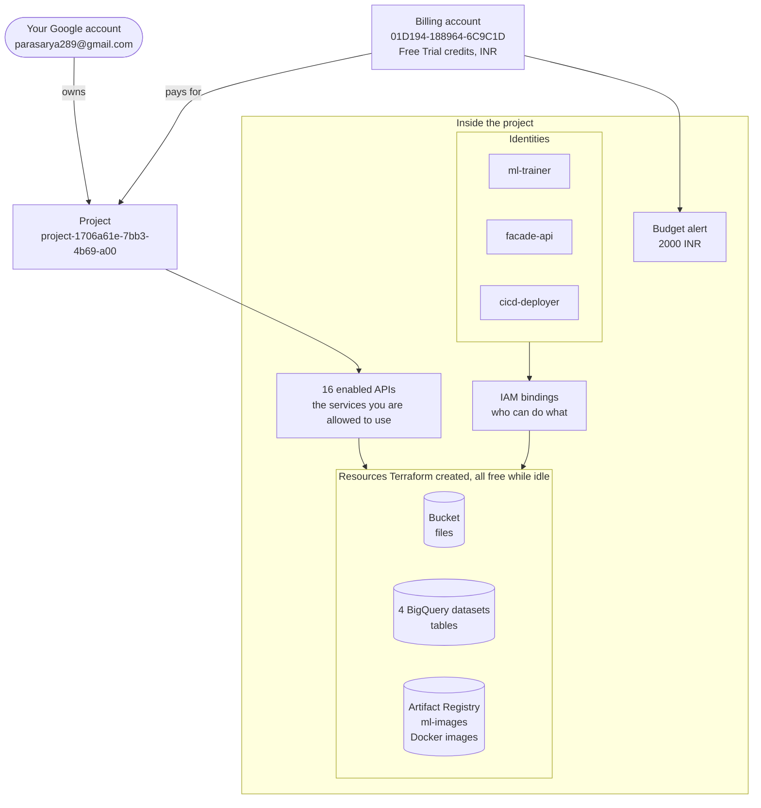
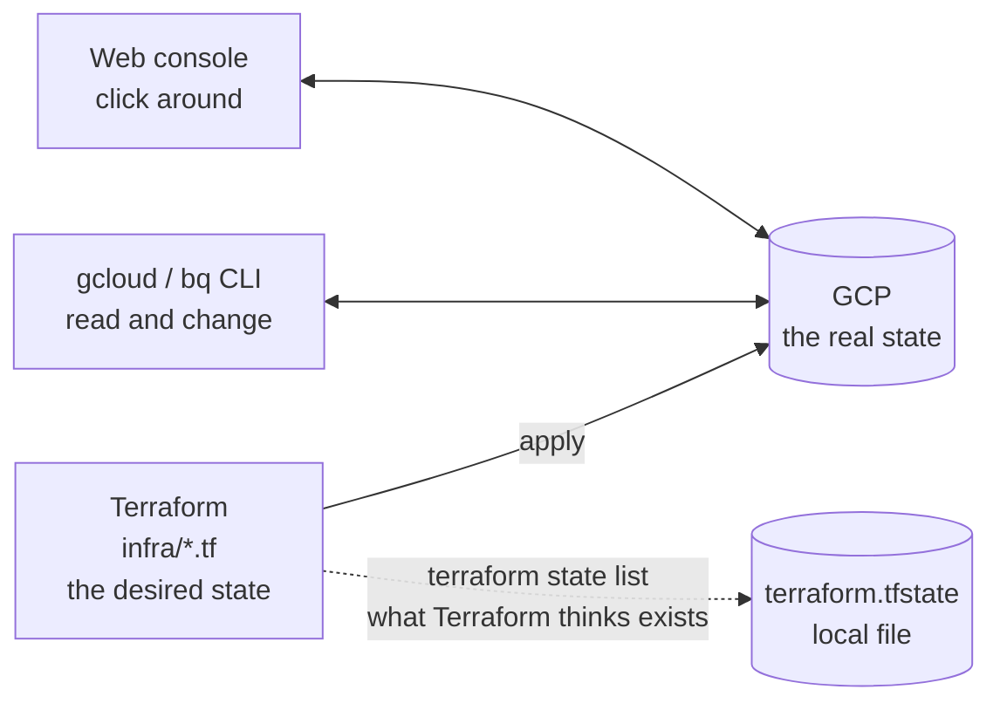
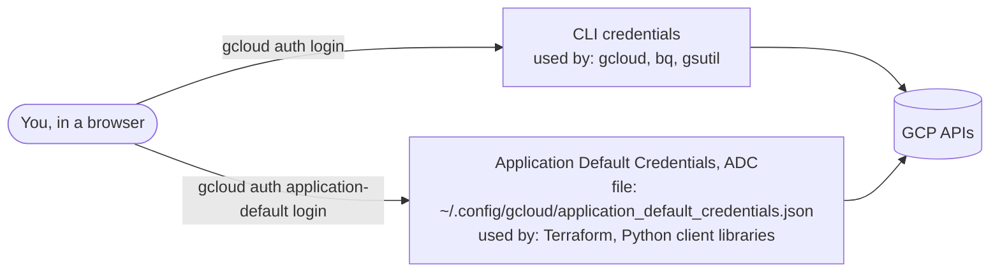
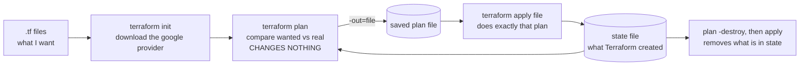

# Learnings

One running log of what was built, what each command did, and what went wrong. Add to it after every phase. The status of each phase lives in [Plan.md](Plan.md); the system diagrams live in [docs/architecture.md](docs/architecture.md).

- [1. The big picture](#1-the-big-picture)
- [2. GCP basics](#2-gcp-basics)
- [3. Finding things: Console, CLI, Terraform](#3-finding-things-console-cli-terraform)
- [4. Logging in: two separate logins](#4-logging-in-two-separate-logins)
- [5. How Terraform works](#5-how-terraform-works)
- [6. Phase 0: every command, in order](#6-phase-0-every-command-in-order)
- [7. Learnings by phase](#7-learnings-by-phase)
- [8. Cost and teardown](#8-cost-and-teardown)

Project used throughout: `project-1706a61e-7bb3-4b69-a00`, region `us-central1`, billing account `01D194-188964-6C9C1D` (currency INR).

---

## 1. The big picture

Everything in GCP hangs off a **project**. A project is billed through a **billing account**. Inside a project you switch on **APIs** (services), and then create **resources** (buckets, datasets, and so on). **Identities** (you, and service accounts) get **roles** that say what they may do.



When fully built (as at the end of Phase 0), the project holds the bucket, registry, 4 datasets, 3 service accounts, 16 IAM bindings, the budget, and 16 enabled APIs. Nothing runs by the hour. **As of 2026-09-30 it is destroyed** (only the 16 free APIs remain enabled); `make plan` then `make apply` rebuilds it in about 2 minutes.

The whole project's job, from `Plan.md`: a model change in git ends up serving traffic safely. The cloud target and its local twin are in [docs/architecture.md](docs/architecture.md), diagram 7.

---

## 2. GCP basics

| Term | Plain meaning | In this project |
|---|---|---|
| **Project** | A container for all your resources, settings, and bills. Has a human name, a unique **ID**, and a numeric **number**. | `project-1706a61e-7bb3-4b69-a00`. Deleting the project deletes everything in it. |
| **Billing account** | The payment source. Projects are *linked* to one. | Free Trial credits. A budget alert is attached to it. |
| **Region** | A physical location, like `us-central1` (Iowa). Resources live in one. | Everything in `us-central1`. Keeping one region avoids cross-region costs and confusion. |
| **Multi-region** | A bucket of regions, like BigQuery `US`. | We deliberately did not use it. |
| **API / service** | A capability you switch on per project. Enabling is free; *using* it may cost. | 16 enabled. See below. |
| **Resource** | A thing you create: a bucket, dataset, cluster, endpoint. | 8 resource types created in Phase 0. |
| **IAM** | Who (principal) can do what (role) on which resource. | 15 project-level roles and 1 bucket role. |
| **Principal** | A user, group, or service account. | You, plus 3 service accounts. |
| **Role** | A named bundle of permissions, like `roles/bigquery.jobUser`. | See the IAM table in `infra/main.tf`. |
| **Service account (SA)** | A robot identity for programs, not people. No password; it gets permissions through roles. | `ml-trainer` (training jobs), `facade-api` (the API on GKE), `cicd-deployer` (GitHub Actions). |
| **Quota project** | The project a request is billed and rate-limited against. | Matters for the Billing Budget API. |

### The 16 enabled APIs

| API | Used for | Phase |
|---|---|---|
| `serviceusage`, `cloudresourcemanager`, `iam`, `iamcredentials`, `billingbudgets` | Plumbing: enabling APIs, project IAM, service accounts, short-lived credentials, the budget | 0, 4, 5 |
| `bigquery`, `bigquerystorage` | Tables and fast reads | 1, 2 |
| `dataform`, `workflows`, `cloudscheduler` | SQL transforms, orchestration, scheduling | 1, 6 |
| `aiplatform` | Vertex AI: training, registry, endpoints, pipelines, monitoring | 2, 3, 6, 7 |
| `artifactregistry`, `cloudbuild` | Store and build Docker images | 3 |
| `container` | GKE | 4 |
| `logging`, `monitoring` | Logs, dashboards, alerts | 4, 7 |

**Enabling an API costs nothing.** Only `aiplatform` (endpoints) and `container` (GKE clusters) can bill *by the hour*, and only once you create an endpoint or cluster.

### What bills, and how

| Billing model | Examples | Risk |
|---|---|---|
| **Free at idle** | IAM, service accounts, enabling APIs | None |
| **Per GB stored or queried** | Bucket, BigQuery, Artifact Registry | Tiny at 10k rows |
| **Per hour, running or not** | Vertex endpoints, GKE clusters, VMs | **This is the one to watch** |

---

## 3. Finding things: Console, CLI, Terraform

The same resource can be seen three ways. When something looks wrong, check all three.



If someone clicks a resource into existence in the console, Terraform does not know about it. That is called drift.

### Console: where to click

Open https://console.cloud.google.com and pick the project in the top bar. Or use these direct links (the `?project=` part selects the project):

| I want to see | Menu path | Link |
|---|---|---|
| Is everything healthy and what is enabled | APIs & Services → Enabled APIs | https://console.cloud.google.com/apis/dashboard?project=project-1706a61e-7bb3-4b69-a00 |
| Files in the bucket | Cloud Storage → Buckets | https://console.cloud.google.com/storage/browser?project=project-1706a61e-7bb3-4b69-a00 |
| Tables and SQL | BigQuery → Studio | https://console.cloud.google.com/bigquery?project=project-1706a61e-7bb3-4b69-a00 |
| Docker images | Artifact Registry | https://console.cloud.google.com/artifacts?project=project-1706a61e-7bb3-4b69-a00 |
| Who can do what | IAM & Admin → IAM | https://console.cloud.google.com/iam-admin/iam?project=project-1706a61e-7bb3-4b69-a00 |
| The robot accounts | IAM & Admin → Service Accounts | https://console.cloud.google.com/iam-admin/serviceaccounts?project=project-1706a61e-7bb3-4b69-a00 |
| Money: credits, days left, spend | Billing → Overview | https://console.cloud.google.com/billing |
| The budget alert | Billing → Budgets & alerts | https://console.cloud.google.com/billing/01D194-188964-6C9C1D/budgets |
| Logs from anything | Logging → Logs Explorer | https://console.cloud.google.com/logs/query?project=project-1706a61e-7bb3-4b69-a00 |
| All running things, to spot leaks | (later) Vertex AI → Endpoints, Kubernetes Engine → Clusters | https://console.cloud.google.com/vertex-ai/endpoints?project=project-1706a61e-7bb3-4b69-a00 |

Console layouts change over time. If a link misses, use the left-hand menu (the ☰ icon) or the search bar at the top, which finds any page by name.

### CLI: the commands you will use most

Put this in `~/.zshrc` once: `export PATH=/opt/homebrew/share/google-cloud-sdk/bin:$PATH`. Set `P=project-1706a61e-7bb3-4b69-a00` in your shell to shorten the commands below.

| Question | Command |
|---|---|
| Who am I logged in as? | `gcloud auth list` |
| Which project is selected? | `gcloud config get-value project` |
| Select a project | `gcloud config set project $P` |
| Describe the project | `gcloud projects describe $P` |
| Which billing accounts do I have? | `gcloud billing accounts list` |
| Is billing linked to the project? | `gcloud billing projects describe $P` |
| What APIs are on? | `gcloud services list --enabled --project $P` |
| Turn an API on | `gcloud services enable <name>.googleapis.com --project $P` |
| List buckets / files | `gcloud storage buckets list --project $P` · `gcloud storage ls gs://$P-ml` |
| Copy a file to the bucket | `gcloud storage cp data/data.csv gs://$P-ml/raw/` |
| List BigQuery datasets | `bq --project_id=$P ls` |
| Run SQL | `bq --project_id=$P query --use_legacy_sql=false 'SELECT 1'` |
| List image repos | `gcloud artifacts repositories list --location us-central1 --project $P` |
| List service accounts | `gcloud iam service-accounts list --project $P` |
| Who has which role? | `gcloud projects get-iam-policy $P` |
| List budgets | `gcloud billing budgets list --billing-account=01D194-188964-6C9C1D` |
| **Leak check: anything hourly?** | `gcloud container clusters list --project $P` · `gcloud ai endpoints list --region us-central1 --project $P` · `gcloud compute instances list --project $P` |

Reading help: add `--help` to any command, or `gcloud help`. Add `--format=json` to see every field, or `--format="value(name)"` for one.

---

## 4. Logging in: two separate logins

This one is confusing at first. There are two separate credentials, for two kinds of tools.



- If `gcloud` works but `terraform` says "could not find default credentials", you skipped the second login.
- Neither login is a service account key file. We avoid key files entirely (Agents.md rule 6). Later, GitHub Actions will use Workload Identity Federation instead.

---

## 5. How Terraform works



- **State** is Terraform's memory of what it created. It is a local file here, and it is gitignored, because state can contain sensitive values.
- **Plan first, always.** It shows `+ create`, `~ change`, `- destroy` before anything happens.
- **Apply a saved plan** and you get exactly what you reviewed. Apply without one and Terraform re-plans, asks you to type `yes`, and the world may have changed in between.
- **A second plan right after apply should say "No changes".** That proves the apply is stable.

---

## 6. Phase 0: every command, in order

Goal: a foundation that builds and tears down cleanly. Done when `make apply` and `make destroy` both run cleanly.

### A. Install the tools (macOS)

| Command | What it does | Note |
|---|---|---|
| `brew install hashicorp/tap/terraform` | Installs Terraform (v1.16.4) | Needed the HashiCorp tap |
| `brew install --cask gcloud-cli` | Installs the `gcloud` CLI and `bq` | First try failed on a network reset; the retry worked |
| `export PATH=/opt/homebrew/share/google-cloud-sdk/bin:$PATH` | Makes `gcloud` findable | Add to `~/.zshrc` to keep it |

### B. Check the Terraform before touching GCP

| Command | What it does | Result |
|---|---|---|
| `terraform init -backend=false` (in `infra/`) | Downloads the provider without needing GCP | ok |
| `terraform validate` | Checks the config for mistakes, with no credentials | **Caught a real bug** (see section 7) |
| `terraform fmt -check` | Checks formatting | clean after one fix |

### C. Log in (you ran these, in your own terminal)

| Command | What it does |
|---|---|
| `sudo chown -R $(whoami) ~/.config` | Fixed `~/.config`, which was owned by root, so gcloud could not save its login |
| `gcloud auth login` | CLI login (browser) |
| `gcloud auth application-default login` | ADC login for Terraform (browser) |

### D. Inspect the account before building (read-only)

| Command | What it told us |
|---|---|
| `gcloud auth list` | Logged in as parasarya289@gmail.com |
| `gcloud projects describe project-1706a61e-7bb3-4b69-a00` | Project exists and is `ACTIVE` |
| `gcloud billing accounts list` | One account, **currency INR** |
| `gcloud billing projects describe $P` | Billing is linked |
| `gcloud services list --enabled --project $P` | Some APIs (BigQuery, Dataform) were already on |
| `gcloud container clusters list`, `gcloud ai endpoints list`, `gcloud compute instances list` | Hourly services were not enabled, so none could exist |

### E. Build, version 1

I wrote `infra/terraform.tfvars` (gitignored) with the project ID, region, billing account, currency, and a 2000 INR budget. Then:

| Command | What it does | Result |
|---|---|---|
| `make init` | `terraform init`: download the provider | ok |
| `terraform plan -out=phase0.tfplan -var project_id=$P` | Compute and save the plan | **Plan: 42 to add, 0 to change, 0 to destroy** |
| `terraform apply phase0.tfplan` | Create exactly what the plan said | **42 added** |
| `terraform plan` again | Check stability | **No changes** |

`make plan` runs the same plan with your project from `gcloud config`. `make apply` and `make destroy` work in a normal terminal but stop at a "type yes" prompt, which is why saved plan files were used here.

### F. Verify in GCP, not just in Terraform's words

| Command | Confirms |
|---|---|
| `gcloud storage buckets describe gs://$P-ml` | Bucket exists, location US-CENTRAL1 |
| `gcloud artifacts repositories list --location us-central1 --project $P` | `ml-images`, format DOCKER |
| `bq --project_id=$P ls` | `raw`, `staging`, `features`, `serving_logs` |
| `gcloud iam service-accounts list --project $P` | The 3 service accounts |
| `gcloud billing budgets list --billing-account=01D194-188964-6C9C1D` | Budget, INR 2000 |
| `gcloud services list --enabled ...` | All 16 of our APIs on |
| `terraform state list` | The 42 things Terraform tracks |

### G. Destroy

| Command | What it does | Result |
|---|---|---|
| `terraform plan -destroy -out=destroy.tfplan -var project_id=$P` | Show what would be removed | **42 to destroy** |
| `terraform apply destroy.tfplan` | Do it | 42 destroyed |
| the checks from F, again | Each resource must be gone | all gone, **APIs still on**, state empty |

### H. Build, version 2

Plan again (identical: 42 to add), apply, verify with the commands from F, second plan says "No changes". This satisfies ground rule 6: rebuild from destroy to deployed at least twice.

### What Phase 0 created

| Resource | Count | Cost while idle |
|---|---|---|
| APIs enabled | 16 | free |
| Storage bucket `project-1706a61e-7bb3-4b69-a00-ml` | 1 | free |
| Artifact Registry repo `ml-images` | 1 | free |
| BigQuery datasets | 4 | free |
| Service accounts | 3 | free |
| IAM bindings | 16 | free |
| Budget alert (2000 INR at 50/80/100%) | 1 | free, alerts only |

---

## 7. Learnings by phase

Add a short entry after each phase: what surprised you, what broke, what you would do differently.

### Phase 0: Foundation (done)

**Mistakes the tooling caught before anything cost money**
- **A service account ID must be 6 to 30 characters.** `cicd` was 4. `terraform validate` caught it, and it is now `cicd-deployer`. Validate works offline, so run it often.
- **Three APIs were missing** from the list: `cloudresourcemanager`, `iam`, `serviceusage`. Without them the first apply would fail with a 403 on IAM.
- **Budget currency must match the billing account.** Ours is INR. Hardcoding USD would have been rejected. It is now `budget_currency`.
- **The Billing Budget API needs a quota project** when you call it with user credentials. It is handled with a second provider block just for that resource.
- **`bq_location = "US"` was a multi-region**, which broke the one-region rule. Now `us-central1`.

**Things about how GCP behaves**
- **`disable_on_destroy = false` on APIs.** Destroy removes the API from Terraform's state but leaves it enabled. Reasons: disabling can fail on dependencies, it would switch off APIs that were enabled before this repo, it slows rebuilds, and enabling is free. Trade-off: `destroy` is not a full clean slate.
- **Enabling an API is free; creating some resources is not.** Only Vertex endpoints and GKE clusters bill by the hour.
- **Some APIs were already on** in a new project (BigQuery, Dataform). Terraform adopted them without complaint.
- **IAM changes take about a minute** to create. Terraform shows "Still creating" for a while. That is normal.

**Things about the tools**
- **macOS ships GNU Make 3.81**, which ignores `.RECIPEPREFIX`. The Makefile used it, so no target ever ran on this machine. It now uses tabs.
- **`~/.config` was owned by root**, so gcloud could not store a login. One `chown` fixed it.
- **Passing a plan file to `apply`** skips the "type yes" prompt and guarantees what runs. That is how the agent ran the apply here.
- **A check script can be wrong while the system is right.** My `grep "Destroy complete"` found nothing, because applying a saved destroy plan prints "Apply complete! ... 42 destroyed". Always read the actual output.

**Status:** apply, destroy (verified in GCP), apply again, and a clean second plan. IAM roles are still project-wide. Tighten them in Phase 5.

### Phases 1 to 8: built locally first, cloud still to do

The local versions ran on Docker Compose with files instead of BigQuery and GCS. They are proven locally and have nothing cloud-side yet. Each cloud phase should add its own entry here.

**Phase 1, data and ELT.** *Local:* `make_data.py` with a fixed seed, `--shuffle-labels` and `--shift-features` flags. *Learned:* a fixed seed makes every later check reproducible. *Cloud to do:* CSV to GCS, load into `raw`, Dataform, Workflows, Scheduler.

**Phase 2, training.** *Local:* `train_clf.py` and `train_uplift.py` run from the CLI. *Learned:* the AUC and Qini metrics separate good data from shuffled data clearly (AUC 0.65 vs 0.50), which is what the later quality gate relies on. *Cloud to do:* Vertex Custom Jobs, Experiments, Model Registry aliases.

**Phase 3, serving.** *Local:* one FastAPI image serves either model, using Vertex's `instances`/`predictions` format so it deploys unchanged. *Learned:* a model file pickled with one scikit-learn version needs the same version at serving time, so the serving image pins the training versions. *Cloud to do:* Cloud Build, Vertex Endpoints (the first thing that bills by the hour), `serving_logs` in BigQuery.

**Phase 4, facade.** *Local:* calls both models in parallel with a 2 second timeout, and degrades to classification-only if uplift fails. *Learned:* a refused connection fails in 10 ms, but a hung server takes the full timeout, and both paths need testing. *Cloud to do:* GKE Autopilot, Workload Identity, HPA, Kustomize, a load test.

**Phase 5, CI/CD.** *Local and GitHub:* lint, 29 tests, and an end-to-end smoke test pass on GitHub Actions. *Learned:* **the first CI run failed** because a test imported a module that loaded a model file at import time. It passed locally only because the file existed. CI runs on a clean checkout, and that is what exposes hidden dependencies. The fix was to load the model at startup. *Cloud to do:* deploy on merge, Workload Identity Federation, rollback on failed probes, tighter roles.

**Phase 6, pipelines.** *Local:* a quality gate rejects a model trained on shuffled labels. *Learned:* **measure a threshold before trusting it.** The uplift floor was close to a coin flip (it passed 8 of 20 shuffled runs), so it was re-set to 0.005 from a 40-seed measurement. The classifier floor is what reliably caught bad models. *Cloud to do:* a KFP pipeline on Vertex, the real Model Registry, caching, Scheduler.

**Phase 7, release safety.** *Local:* drift detection with PSI on serving logs. *Learned:* PSI silently reported 0 for binary features, so a real drift would have gone unseen. A test that passes can still be testing the wrong thing. *Cloud to do:* canary traffic split, Vertex Model Monitoring, Cloud Monitoring alerts.

**Phase 8, close the loop.** *Local:* drift triggers retraining, which registers a candidate but never promotes it. *Learned:* promote and deploy are separate steps, so a human decision sits between "a new model exists" and "it serves traffic". *Cloud to do:* alert-triggered retraining, `make teardown`, the final README pass.

---

## 8. Cost and teardown

**Before every session ends, run this leak check.** Anything printed is something billing by the hour.

```
P=project-1706a61e-7bb3-4b69-a00
gcloud container clusters list --project $P
gcloud ai endpoints list --region us-central1 --project $P
gcloud compute instances list --project $P
```

| To remove | Command |
|---|---|
| Everything Terraform created (asks first) | `make destroy`, after reading the plan |
| Only things Terraform did not create (endpoints, cluster) | Delete them by hand first. `make teardown` prints this reminder. |
| Stop the local containers | `make down` |

Watch the **Billing → Overview** page for credits and days remaining. The 2000 INR budget only emails you; it does not stop anything. Stay on the Free Trial account and never click **Upgrade**.
